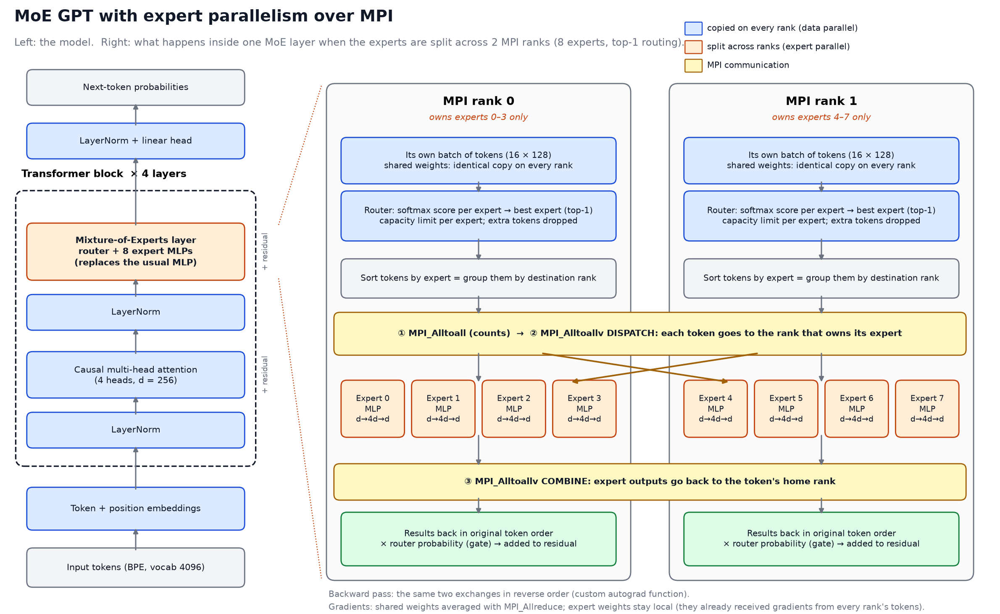
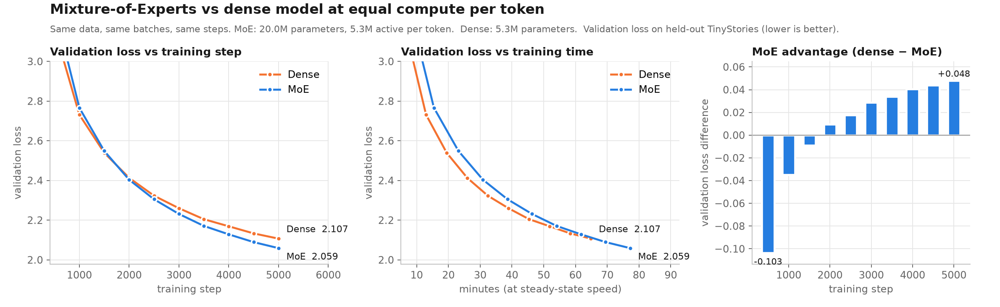
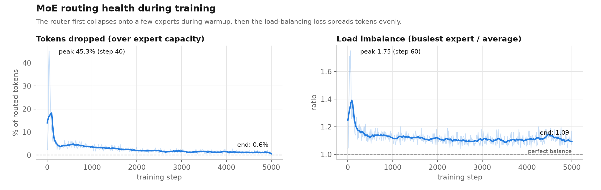

# Mixture-of-Experts GPT with expert parallelism over MPI

A small GPT-style language model whose feed-forward layers are Mixture-of-Experts (MoE), trained with **expert parallelism**: the experts are split across MPI processes, and tokens are exchanged between processes with `MPI_Alltoallv` inside every forward and backward pass.

I built this to understand how large MoE models are trained across machines. It runs on CPU with Python, PyTorch and mpi4py.



## Results

Two models were trained on TinyStories with the same data, the same batches and the same number of steps:

- **MoE:** 8 experts per layer, top-1 routing
- **Dense baseline:** one MLP per layer, the size of one expert

Both models do the same computation per token. The MoE holds about 4× more parameters.

| Model | Total params | Active params / token | Val loss | Perplexity | Tokens/s |
|---|---|---|---|---|---|
| Dense | 5.3M | 5.3M | 2.107 | 8.22 | 5,264 |
| MoE (8 experts, top-1) | 20.0M | 5.3M | **2.059** | **7.84** | 4,421 |



- **Per step, the MoE wins.** It overtakes the dense model between steps 1,500 and 2,000. After that the gap keeps growing, reaching 0.048 at step 5,000 (4.7% lower perplexity).
- **The MoE is slower.** Throughput is 16% lower, from routing, sorting tokens and the all-to-all exchanges.
- **Per minute, it's close to a tie at this scale.** The MoE reaches the dense model's final loss in about 4,300 steps (about 15% fewer, interpolated between evaluations). Its lower throughput cancels most of that gain on this hardware.
- One seed per model. Validation is computed on the same ~82k held-out tokens at every evaluation.

### Routing



During warmup, the router sends most tokens to a few experts. Up to 45% of tokens are dropped because those experts are over capacity. The load-balancing loss then spreads tokens out: by the end, under 1% are dropped and the busiest expert gets 1.09× the average load.

### Correctness

`--mode dp` runs the same model with every expert copied on every rank, and no all-to-all. Both modes use the same initialisation and the same routing, so their losses must match. On 4 ranks they are identical for the first steps, then differ only in the 4th decimal: 1.1025 vs 1.1022 at step 30 (`results/check_ep.json`, `results/check_dp.json`). The small drift comes from floating-point sums done in a different order, which can flip a few routing decisions.

## How it works

Each MPI rank holds:

- a full copy of the **shared weights** (embeddings, attention, routers), trained on its own batches (data parallel)
- **E/P of the experts** (expert parallel). With 8 experts on 2 ranks, rank 0 owns experts 0–3 and rank 1 owns 4–7.

In every MoE layer:

1. The router picks one expert per token (top-1). Each expert accepts at most `capacity_factor × tokens / E` tokens; extra tokens skip the layer through the residual connection.
2. Tokens are sorted by expert id. Because experts are numbered rank by rank, this also groups them by destination rank.
3. `MPI_Alltoall` exchanges token counts, then `MPI_Alltoallv` sends each token to the rank that owns its expert.
4. Each rank runs its local experts on the tokens it received.
5. A second `MPI_Alltoallv` sends the results back to each token's original rank, where they are multiplied by the router probability and added to the residual.

**Backward pass.** The exchange is a custom `torch.autograd.Function` whose backward is the reverse all-to-all, so each MoE layer does 4 all-to-alls per step.

**Gradients.** Shared weights are averaged with `MPI_Allreduce`. Expert weights need no communication: the reverse exchange already brought each expert the gradients from every rank's tokens, so they are only divided by the number of ranks.

On one machine, all-to-all takes about 2–4% of step time and all-reduce about 1%.

## A bug worth mentioning

The first longer runs crashed with `free(): corrupted unsorted chunks` inside `MPI_Alltoallv`.

The cause: when the router sent every token of a step to experts on the other rank, this rank's experts received nothing. The expert output then no longer depended on the received tokens, so PyTorch skipped this rank's backward all-to-alls, while the other rank still called them. The ranks fell out of step on their collective calls, message sizes stopped matching, and memory got corrupted.

I found it by logging every all-to-all call per rank and comparing the sequences. The fix keeps the expert output attached to the graph (`out = recv * 0.0`) so every rank always makes the same calls, and counts missing gradients as zeros so all-reduce buffers always have the same size. A learning-rate warmup also stopped the router from collapsing so early.

## Running it

Requires an MPI implementation (Open MPI or MPICH).

```bash
python -m venv .venv && source .venv/bin/activate
pip install -r requirements.txt

# data: a 50 MB slice of TinyStories
mkdir -p data && cd data
wget https://huggingface.co/datasets/roneneldan/TinyStories/resolve/main/TinyStoriesV2-GPT4-train.txt
wget https://huggingface.co/datasets/roneneldan/TinyStories/resolve/main/TinyStoriesV2-GPT4-valid.txt
head -c 50M TinyStoriesV2-GPT4-train.txt > tinystories.txt && cd ..
python train_tokenizer.py --data data/tinystories.txt --vocab 4096 --out data/tok.json

# correctness check (synthetic data, a few seconds)
mpirun -np 4 python moe_ep.py --mode ep --steps 30 --gen 0
mpirun -np 4 python moe_ep.py --mode dp --steps 30 --gen 0

# MoE vs dense (65–80 min each on an 8-thread laptop)
COMMON="--data data/tinystories.txt --tokenizer data/tok.json --val data/TinyStoriesV2-GPT4-valid.txt \
  --d 256 --layers 4 --heads 4 --experts 8 --ctx 128 --batch 16 --steps 5000"
mpirun -np 2 --bind-to none python moe_ep.py --mode ep    $COMMON --log results/cmp_moe.json   > results/cmp_moe.out
mpirun -np 2 --bind-to none python moe_ep.py --mode dense $COMMON --log results/cmp_dense.json > results/cmp_dense.out

# figures and table
python compare.py --moe results/cmp_moe --dense results/cmp_dense
```

If Open MPI crashes inside PyTorch with large messages, try `--mca pml ob1 --mca btl self,vader`.

**Setup used for the results:** CPU-only laptop (8 threads, 7.5 GB RAM), 2 ranks, d=256, 4 layers, 4 heads, context 128, batch 16 per rank, AdamW (lr 1e-3, 100 warmup steps), capacity factor 1.25, balance-loss weight 0.01, BPE vocabulary of 4096. 5,000 steps = 20.5M tokens, about 1.6 passes over the 13.1M-token training slice.

## Files

| File | Purpose |
|---|---|
| `moe_ep.py` | Model, MPI expert parallelism, training, validation, text generation |
| `train_tokenizer.py` | Trains the byte-level BPE tokenizer |
| `compare.py` | MoE vs dense figures and summary table |
| `arch_figure.py` | Draws the architecture diagram |
| `results/` | Logs (`.json`, `.out`), figures, `summary.md` |

## Limitations and next steps

- Single node only. The real cost of all-to-all appears across machines; scaling runs at 1, 2 and 4 ranks and over a network are next.
- Blocking communication. Overlapping the all-to-all with expert computation (`MPI_Ialltoallv` on chunks) would hide part of the 16% slowdown.
- CPU and Python. On GPUs the same design maps to NCCL (`torch.distributed.all_to_all_single`) or CUDA-aware MPI.
- Next: turn GPT-2 Small into an MoE ("sparse upcycling") and train it with the same expert parallelism on GPUs.

## References

- Shazeer et al., 2017. *Outrageously Large Neural Networks: The Sparsely-Gated Mixture-of-Experts Layer.*
- Lepikhin et al., 2020. *GShard: Scaling Giant Models with Conditional Computation and Automatic Sharding.*
- Fedus, Zoph, Shazeer, 2021. *Switch Transformers* (top-1 routing, capacity factor, load-balancing loss).
- Eldan and Li, 2023. *TinyStories.*
